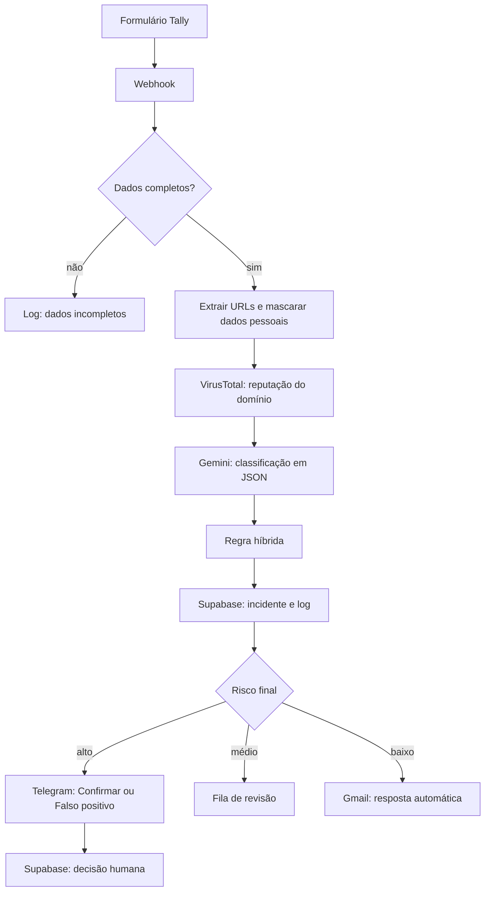

# Triagem inteligente de e-mails suspeitos (phishing)

Automação em **n8n** que recebe e-mails reportados por colaboradores de uma empresa fictícia, consulta a reputação dos links, classifica o risco com IA e decide a ação: alertar uma pessoa, enviar para revisão ou responder automaticamente.

Projeto da disciplina Automação de Processos e Workflows (UniFECAF). Todos os dados de teste são fictícios.

Vídeo pitch: `[https://youtu.be/RkfwzAt52IE]`

## Problema

Hoje o colaborador encaminha um e-mail suspeito e alguém da segurança precisa abrir, avaliar e responder, tudo manualmente. Com mais volume vêm atrasos, respostas inconsistentes e nenhum histórico. Este workflow faz a triagem inicial e deixa a decisão sobre os casos graves para uma pessoa.

## Arquitetura



Um segundo workflow (`Triagem de phishing - erros`) é acionado por qualquer falha do principal: registra o nó que falhou e avisa no Telegram.

## Sistemas integrados

| Sistema | Uso |
|---|---|
| Tally | formulário de reporte (gatilho) |
| n8n Cloud | orquestração |
| VirusTotal | reputação do domínio de cada link |
| Gemini (`gemini-3-flash-preview`) | classificação do e-mail |
| Supabase (PostgreSQL) | incidentes e log de execuções |
| Telegram | alerta com validação humana |
| Gmail | resposta automática ao colaborador |

## Função da IA

O Gemini recebe assunto, domínio do remetente, corpo (já mascarado) e a reputação dos links, e devolve um JSON com `classificacao` (phishing, suspeito, legitimo ou indeterminado), `risco`, `indicadores`, `justificativa`, `confianca` e `acao_recomendada`.

Decisões para manter a IA sob controle:

- o corpo entra no prompt como **dado**, entre tags, e ordens escritas dentro do e-mail são ignoradas;
- a resposta é validada: se o JSON for inválido ou vier fora das opções permitidas, o resultado vira `indeterminado` e o caso vai para revisão humana;
- uma **regra híbrida** só sobe o risco, nunca o reduz: URL com 2 ou mais detecções maliciosas, falha da IA, classificação diferente de `legitimo` e reputação incompleta elevam o risco mínimo;
- só e-mails `legitimo` com risco baixo e reputação completa recebem resposta automática.

## Principais nós

| Nó | Função |
|---|---|
| Webhook + Edit Fields | recebe o Tally e extrai os campos pelo rótulo |
| Dados completos? (If) | exige remetente, assunto, corpo e e-mail do colaborador |
| Preparar dados (Code) | extrai até 3 URLs, separa domínios, remove tags do delimitador e mascara CPF, CNPJ, cartão, e-mail e telefone |
| Consultar VirusTotal (HTTP Request) | 1 chamada por domínio, com intervalo, tentativas e continuação em caso de erro |
| Classificar com Gemini | classificação em JSON |
| Validar resposta da IA (Code) | converte e valida o JSON, com fallback |
| Regra híbrida (Code) | calcula o risco final e a ação |
| Montar registro e Gravar incidente | grava sem o corpo do e-mail e sem o que vem depois do `?` nas URLs |
| Rotear por risco (Switch) | alto, médio, baixo e saída para valores inesperados |
| Pedir validação (Telegram, Send and Wait) | botões Confirmar e Falso positivo |
| Atualizar decisão (Supabase) | grava `confirmado` ou `falso_positivo` |
| Responder colaborador (Gmail) | mensagem genérica, só se o e-mail informado tiver formato válido |

## Como executar

1. **Supabase:** crie um projeto e rode `sql/schema.sql` no SQL Editor.
2. **Tally:** crie um formulário com os campos `Remetente`, `Assunto`, `Corpo`, `Link` (opcional) e `E-mail colaborador`. O workflow lê os campos por esses rótulos.
3. **Credenciais no n8n** (todas pelo cofre de credenciais, nunca dentro dos nós):
   - Telegram API (token do bot)
   - Header Auth para o VirusTotal, com nome `x-apikey`
   - Google Gemini API
   - Supabase (URL do projeto e chave secreta)
   - Gmail OAuth2
4. **Importe** os dois arquivos de `workflows/`. Em cada nó, selecione a credencial correspondente e substitua `SEU_CHAT_ID` pelo ID do seu chat do Telegram.
5. No workflow principal, em **Settings**, defina `Triagem de phishing - erros` como **Error workflow**.
6. **Publique** os dois workflows e configure no Tally um webhook apontando para a **Production URL** do nó Webhook.
7. Envie os casos de `testes/emails_de_teste_phishing.xlsx` pelo formulário. Use o seu próprio e-mail no campo do colaborador, porque os casos de risco baixo enviam uma resposta de verdade.

## Testes e evidências

Foram executados **13 e-mails fictícios** de uma bateria própria, cada um com a classificação e o risco esperados definidos antes da execução. Resultado: a classificação coincidiu com a esperada em **9 dos 13** casos, e o risco final em **11 dos 13**. O detalhe de cada caso está na planilha.

Nos 3 casos com tentativa de injeção de prompt, a IA não obedeceu à instrução embutida.

Casos em que a classificação diferiu:

- **Caso 9:** domínio parecido com o do RH, sem link. A IA respondeu `legitimo` / `baixo`.
- **Caso 16:** phishing cordial, sem urgência. A IA respondeu `legitimo` / `baixo`; o risco final subiu para médio pela regra de reputação incompleta.
- **Caso 13:** quase sem informação. A IA respondeu `suspeito` com risco baixo; a regra elevou para médio e o caso foi para revisão.
- **Caso 14:** injeção em e-mail de aparência neutra. A IA foi mais severa que o esperado (`phishing` / `alto`).

O caso 18 usa um domínio real de teste de antivírus e o VirusTotal devolveu 17 detecções maliciosas. A elevação de risco pela regra híbrida foi demonstrada com dados simulados, e a falha de resposta da IA (JSON inválido) também foi simulada.

| Evidência | Arquivo |
|---|---|
| Fluxo principal completo | `docs/img/fluxo-principal.png` |
| Alerta no Telegram com botões | `docs/img/telegram-alerta.png` |
| Incidente confirmado e falso positivo | `docs/img/incidentes.png` |
| Log com 3 linhas por execução | `docs/img/execucoes-log.png` |
| Falha de gravação e aviso do workflow de erro | `docs/img/erro-workflow.png` |
| Dados incompletos registrados | `docs/img/dados-incompletos.png` |

## Segurança

- Chaves e tokens ficam só no cofre de credenciais do n8n. Os JSONs exportados não contêm segredos, e o ID do chat foi trocado por `SEU_CHAT_ID`.
- CPF, CNPJ, cartão, e-mail e telefone são mascarados antes de chegar à IA.
- O corpo do e-mail não é gravado. O banco guarda assunto (mascarado), domínio, URLs sem parâmetros, reputação e a análise.
- O log guarda só códigos de erro, nunca o texto completo.
- As tabelas têm Row Level Security ligada.

Limitações: o webhook não tem assinatura de verificação, o mascaramento por regex não é uma garantia, a `confianca` é um número informado pelo modelo e não uma probabilidade, e a resposta automática pode cair na pasta de spam.

## Estrutura do repositório

```
README.md
workflows/    triagem-phishing-principal.json, triagem-phishing-erros.json
sql/          schema.sql
testes/       emails_de_teste_phishing.xlsx
docs/img/     prints de evidência
```
